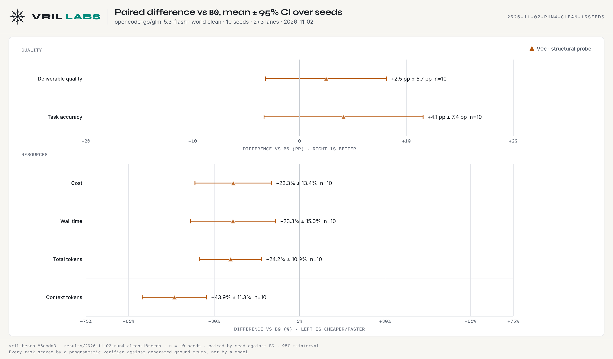
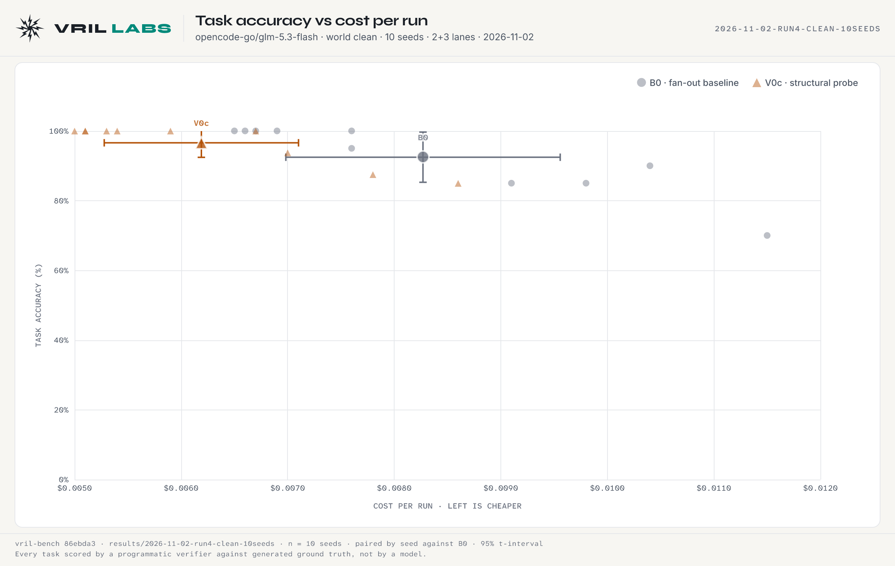
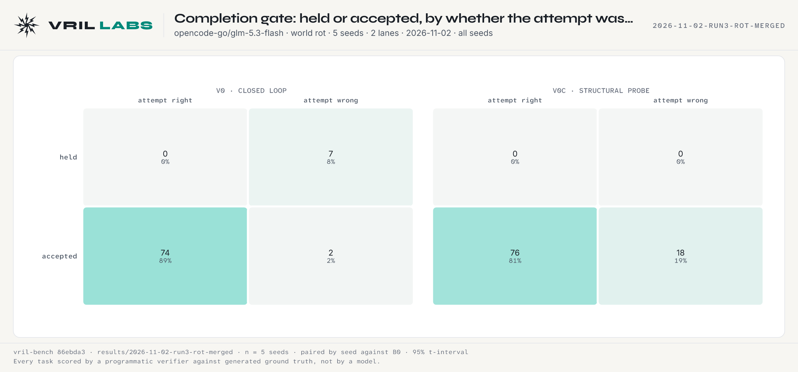

<p align="center">
  
</p>

# Fructigen

[](https://github.com/VRIL-LABS/fructigen/actions/workflows/checks.yml)
[](CHANGELOG.md)
[](pyproject.toml)
[](CONSTRAINTS.md)
[](LICENSE)

Decide a fan-out's shared-context layout before dispatch, and verify it after.

When an orchestrator fans out to several subagents, each one re-reads the same upstream context.
Fructigen takes the fan-out as it is planned and compiles one immutable **prefix plan**: which shared
segments to send in a cache-safe encoded form, which prefix boundaries to mark as cache breakpoints,
and in what order to release the calls so that a prefix is written before it is read. The plan
carries the predicted token classes of every call, so the provider's reported cache counters can be
checked against it.

**Status: alpha. Nothing here has been measured against a real provider.** The cache model reproduces
three recorded probes and is otherwise built from provider documentation. Every saving the planner
prints is a prediction.

## Use

```python
from fructigen.plan import Call, Part, compile_plan
from fructigen.provider import ANTHROPIC_HAIKU_5_5

trunk = Part("recon-handoff", tokens=1200, encoded_tokens=800)
calls = [Call(f"sibling-{i}", (trunk, Part(f"task-{i}", tokens=100))) for i in range(4)]

plan = compile_plan(calls, ANTHROPIC_HAIKU_5_5)
plan.waves          # (('sibling-0',), ('sibling-1', 'sibling-2', 'sibling-3'))
plan.calls[1].usage # Usage(read=800, write=0, uncached=100)
plan.saving         # predicted fraction of baseline input cost
```

Token counts are the caller's to supply. The library ships no tokenizer.

## The baseline it starts from (v0-alpha)

Fructigen is built for the **VRIL LABS Parallel Subtask Agent Workflow**. The figures below measure
that workflow's v0 control plane against naive parallel fan-out. **They are not Fructigen results**:
they are the numbers Fructigen has to improve on, and the reason it exists.

**B0** is naive fan-out: every subagent reads the full upstream context. **V0c** is the v0 closed
loop: admission control decides whether a subagent starts at all, and agents pass compact manifests
instead of transcripts. Every task is scored by a programmatic verifier against generated ground
truth; no model grades the results. Runs are paired by seed, with 95% t-intervals over seeds.

<picture>
  <source media="(prefers-color-scheme: dark)" srcset="assets/benchmark/v0-alpha/paired_forest.dark.png">
  
</picture>

Ten clean seeds on GLM-5.3-Flash, 692 calls:

| | V0c vs B0 | reading |
|---|---|---|
| Deliverable quality | **+2.5 pp ± 5.7** | no regression; the interval spans zero |
| Task accuracy | **+4.1 pp ± 7.4** | no regression; the interval spans zero |
| Cost | **−23.3% ± 13.4** | cheaper, interval clear of zero |
| Wall time | **−23.3% ± 15.0** | faster, interval clear of zero |
| Total tokens | **−24.2% ± 10.9** | fewer, interval clear of zero |
| Context tokens | **−43.9% ± 11.3** | the largest and most reproducible effect |

A cost and latency win at parity, not a quality win.

<picture>
  <source media="(prefers-color-scheme: dark)" srcset="assets/benchmark/v0-alpha/quality_cost.dark.png">
  
</picture>

### Where it does not hold

- **On a stronger model the saving disappears.** On DeepSeek v4.1 Flash, where B0 already scores
  100%, V0c's cost difference is +1.1% ± 28.2 over 5 seeds. The context cut survives (−48.6% ± 5.0).
- **With a silently corrupted lane, the cheap probe accepts wrong work.** V0c accepts 18 wrong
  attempts; the judge variant V0 holds 7 of them and costs about +10.6% for it.

<picture>
  <source media="(prefers-color-scheme: dark)" srcset="assets/benchmark/v0-alpha/gate_matrix.dark.png">
  
</picture>

### What that leaves for Fructigen

The one effect that reproduces on every model and world is the context cut, 29 to 51%. The largest
unclaimed cost is the verifier: the judge that catches corrupted lanes re-reads each worker's whole
prompt at full price. Fructigen targets both: pay for shared context once instead of once per
sibling, and let the verifier read the worker's prompt from cache. Neither has been measured yet.

Figure sources and checksums: [`assets/benchmark/v0-alpha/PROVENANCE.md`](assets/benchmark/v0-alpha/PROVENANCE.md).

## Modules

| Module | What it does |
|---|---|
| `segment` | Typed prompt segments, deterministic stable-first rendering, and prefix identity: a scope digest over everything a provider invalidates on, and a chained hash path |
| `graph` | Validated task graph: nesting-aware topological rank, fan-out |
| `encode` | Cache-safe encoders. One so far: zone-factoring of a dense region map |
| `provider` | Capability descriptors per backend, and a deterministic cache model |
| `plan` | The compiler |
| `render` | A planned call as request content, with breakpoints where the provider supports them |
| `attest` | Hash-path check before a call; realisation (reported over planned cache read) after it, with the cause of a shortfall named |

## Development

```bash
uv venv .venv && uv pip install --python .venv -e ".[dev]"
.venv/Scripts/python -m pytest        # Windows; .venv/bin/python elsewhere
```

Standard library only. This package must never import its consumers.

## Layout

```
src/fructigen/     the package
tests/             its tests
versions/v0-alpha/ verbatim backup of the modules as they stood in vril-bench before the move
```

## Provenance

`graph` adopts the edge and validation design of `google/adk-js` (Apache-2.0). The scope digest in
`segment` adopts the continuity-check idea of `thu-nics/AKV` (Apache-2.0). Both are independent
implementations; no code was copied from either. "Cache-safe" is the term used by
`hystax/optscale-kompressor` (MIT).

## Whitepapers

Fructigen is part of the **VRIL LABS Whitepaper Series** on the Parallel Subtask Agent Workflow.
Its name comes from Volume IV, where the *fructigen field* is the task-context embedding: the seed
kernel a task grows from. A shared prompt trunk is that kernel, shared across lanes.

Series page: [Parallel Subtask Agent Workflow, vril.li/research](https://vril.li/research#whitepapers).

| | Paper |
|---|---|
| Preface | [CSSF](https://vril.li/whitepapers/0-Preface-CSSF.pdf) |
| Contents | [Whitepaper Series](https://vril.li/whitepapers/00-TOC-Whitepaper-Series.pdf) |
| Volume I | [QSC Pre-Flight Gate](https://vril.li/whitepapers/1-Volume-I-QSC-PreFlight-Gate.pdf) |
| Volume II | [Dynagen Manifest](https://vril.li/whitepapers/2-Volume-II-Dynagen-Manifest.pdf) |
| Volume III | [Repulsator Broadcast](https://vril.li/whitepapers/3-Volume-III-Repulsator-Broadcast.pdf) |
| Volume IV | [Fructigen Seed Corpus](https://vril.li/whitepapers/4-Volume-IV-Fructigen-Seed-Corpus.pdf) |
| Volume V | [Swarm Thermodynamics](https://vril.li/whitepapers/5-Volume-V-Swarm-Thermodynamics.pdf) |
| Glossary | [Key Terms and Definitions](https://vril.li/whitepapers/Key-Terms-Definitions-Glossary.pdf) |

## Contributing

Start with [`CONTRIBUTING.md`](CONTRIBUTING.md) and the quality bar in
[`CONSTRAINTS.md`](CONSTRAINTS.md). Coding agents also read [`AGENTS.md`](AGENTS.md); a summary for
language models is in [`llms.txt`](llms.txt).

- Bugs, features and prediction mismatches: [issues](https://github.com/VRIL-LABS/fructigen/issues/new/choose)
- Security problems: [`SECURITY.md`](SECURITY.md), never a public issue
- Getting help: [`SUPPORT.md`](SUPPORT.md)
- What changed: [`CHANGELOG.md`](CHANGELOG.md)

This project follows the [Contributor Covenant](CODE_OF_CONDUCT.md).

## Licence

VRIL LABS Open Source License v1.0. See [`LICENSE`](LICENSE).

---

<p align="center">
  <sub>Built by <strong>VRIL-LABS</strong> · Ancient Knowledge · Future Technology</sub>
</p>
